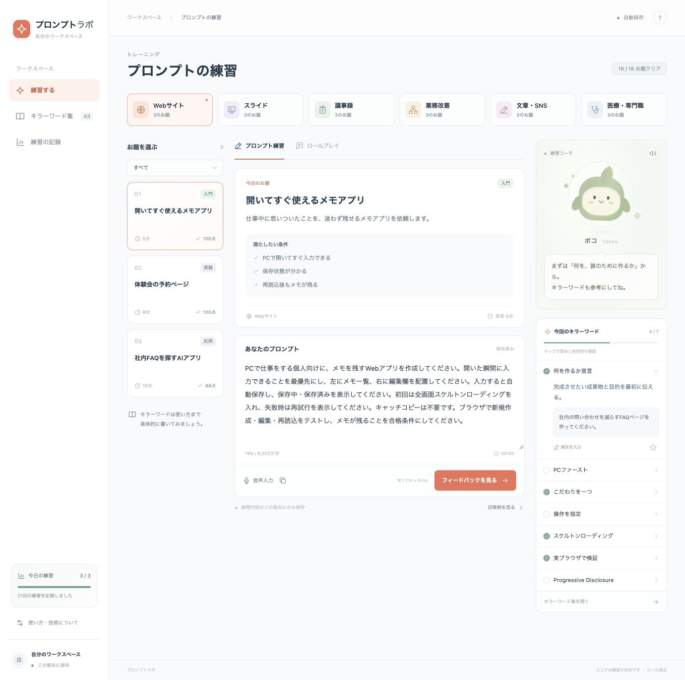

# 検証記録

検証日：2026-10-20。Node.js 25.9.0と利用者端末のGoogle Chromeを使用。ローカルURLは`http://127.0.0.1:4173/`。本番公開環境での検証とは区別する。

## 自動テスト

`npm run check`成功。`npm test`：38件成功、失敗0・スキップ0。

| 範囲 | 件数 | 確認したもの |
|---|---|---|
| 教材・ルール採点 | 9 | 6テーマ18題の参照、空入力、キーワード列挙、全サンプル、同義語、反復、検証の指定、長文とHTML字句、存在しない課題 |
| 自作ワード | 7 | 必須項目と型、文字数境界、URL、重複、編集、HTML字句のデータ保持 |
| Worker API | 15 | health、採点、入力検査、Origin・JSON、サイズ、メソッド、AI未接続、制限未設定・超過・障害、正常応答・chat completion形式、AI障害、思考だけの応答の拒否、静的配信 |
| 音声入力制御 | 7 | 日本語の途中結果・最終結果、重複防止、開始待ちの停止、切替後の遅延結果無視、許可拒否・サービス障害、開始失敗、8,000文字制限 |

AI・音声制御の自動テストはモックを使用。Cloudflare実環境の推論は、下記の公開後の実操作で別に検証した。

## 実ブラウザで操作した範囲

1. 初回画面・全画面スケルトンの存在と表示後の画面を確認。
2. 回答例を開く→本文取得→閉じる→入力欄に入力→キラーワード使用状況・文字数・保存済み表示を確認。
3. 採点後の5軸内訳とキーボード焦点がフィードバックへ移ることを確認。
4. 18題すべてをテーマ・お題ボタンで選択し、回答例を入力して採点（下表）。
5. 練習の記録で回数・平均・18題クリアを確認。
6. ロールプレイで提案を入力・提出し、依頼者から「保存に失敗した場合、何を表示しますか？」の追加質問を確認。
7. AI相談の送信説明→送信→未接続の説明を確認。接続失敗をAI成功として表示しない。
8. 難易度を「応用」にして1件に絞られ、本文も応用のお題になることを確認。
9. ワード検索でToastが1件になることを確認。
10. Progressive Disclosureを意味・例文・参考URLと共に自作ワードとして保存→検索→「このお題で練習」でお題のキラーワードへ追加。
11. 再読み込み後もメモアプリのお題の下書き199文字と追加ワードが残ることを確認。
12. 記録を書き出す操作を実行。生成されたJSONファイルを確認し、アプリ名、履歴21件、自作ワード1件を検証。検証用の教材文のみを使用。
13. 390px幅と1024px幅で`document.documentElement.scrollWidth > window.innerWidth`がfalseであることを確認。小画面のナビ名3件が保持されることを確認。検証後に画面サイズを元へ戻した。
14. 音声入力前の送信先・権限・誤変換の説明を確認。実マイクでの発話認識は、後述の利用者端末で別途確認。
15. 自作ワードの意味を編集して保存→検索結果で更新確認→お気に入りに保存→保存フィルターで1件となることを確認。

ダウンロード待機の自動化APIはタイムアウトしたが、ブラウザの保存通知と実際に生成されたJSONファイルを確認した。音声読み上げボタン操作は行ったが、発声した音の品質は検証していない。

## 全お題のブラウザ採点

| お題ID | 点数 | 内訳 |
|---|---:|---|
| web-memo | 100 | 5軸 |
| web-reservation | 100 | 5軸 |
| web-ai | 88 | 5軸 |
| slides-intro | 94 | 5軸 |
| slides-proposal | 100 | 5軸 |
| slides-animation | 100 | 5軸 |
| minutes-basic | 94 | 5軸 |
| minutes-noisy | 94 | 5軸 |
| minutes-action | 100 | 5軸 |
| workflow-intake | 100 | 5軸 |
| workflow-automation | 94 | 5軸 |
| workflow-roleplay | 94 | 5軸 |
| writing-email | 94 | 5軸 |
| writing-social | 94 | 5軸 |
| writing-video | 100 | 5軸 |
| medical-training | 100 | 5軸 |
| medical-faq | 88 | 5軸 |
| medical-policy | 94 | 5軸 |

いずれも回答例のルール採点が70点以上であることを確認したもので、生成AIが依頼内容の正しさを審査した結果ではない。

## レビューで直したもの

- 履歴詳細を開くと現在のお題の採点が上書きされる問題を修正。
- お題切替時に古い音声結果が新しい下書きへ入らないよう、認識セッションを無効化。
- 小画面でラベルを非表示にしてもナビ名が残るように修正。
- 教材・採点の本文色を濃くし、文字サイズを調整。
- AIの待機タイマー解放、制限サービス障害、画面変更時のリクエスト取消を追加。
- 実在を確認できなかった旧モデル候補を、公式モデル一覧で確認したQwen3へ変更。
- 自作ワード編集画面で、内容の入ったテキストエリアのラベルを明示し、ラベル名から正しく操作できるよう修正。

## Cloudflare公開後の検証

公開URL：[プロンプトラボ](https://prompt-lab.n-pb360-4v.workers.dev/)

Wrangler 4.151.3を利用者の承認後にプロジェクト専用に導入。固定バージョンとpackage-lock.jsonを保存した。公開前のdry-runは成功。Workers AI・Static Assets・Rate Limitの3バインディングを確認。

- 公開時のVersion ID：`51768ffb-e64e-4826-b37e-ca091ed7a134`
- 本番URLをChromeで開き、6テーマ18題すべてを選択→回答例入力→提出→5軸表示を再検証。得点はローカルと一致し、すべて70点以上。[結果JSON](production-scores.json)
- 本番の「AIコーチに相談」から実際のWorkers AIへ送信し、日本語の改善助言を確認。
- 最終版のAIコーチAPIも200で返答（実測約2.65秒）。[応答JSON](production-ai-review.json)
- AIロールプレイの応答取得失敗を再現。思考だけで出力上限を使い切る可能性を考慮し、Qwen公式の`/no_think`を適用。修正後に本番画面から再送信し「メモの保存方法はローカルストレージを使用しますか？」という依頼者役の追加質問を確認。[画面](production-ai-roleplay.jpg)
- 本番`GET /`・`GET /speech.js`は200。`X-Content-Type-Options: nosniff`を確認。
- 本番`GET /api/health`は200、`aiConnected: true`。
- 本番`POST /api/evaluate`は200・回答例100点。別OriginからのPOSTは400。
- 本番の音声開始ボタンが「停止する」に切り替わること、マイク接続待ちから停止できて説明が更新されることを確認。

## 端末での音声確認（利用者確認）

- 2026-10-21、公開画面の音声入力開始・マイク許可・短い発話、およびコーチ右上の読み上げの最終確認依頼に対し、利用者から「音声入力・読み上げとも動いた」との報告を受領。
- 実マイクとスピーカーの動作は利用者端末での確認結果として記録する。エージェントによるブラウザ操作・モックによる音声制御テストとは区別する。
- Google認証は本版では設けていない（端末内保存）。

Web公開、自動テスト38件、全18題の本番ブラウザ操作、実Workers AIの返答、利用者端末での音声入力・読み上げを確認済み。依頼範囲の検証を完了した。

## 画面

